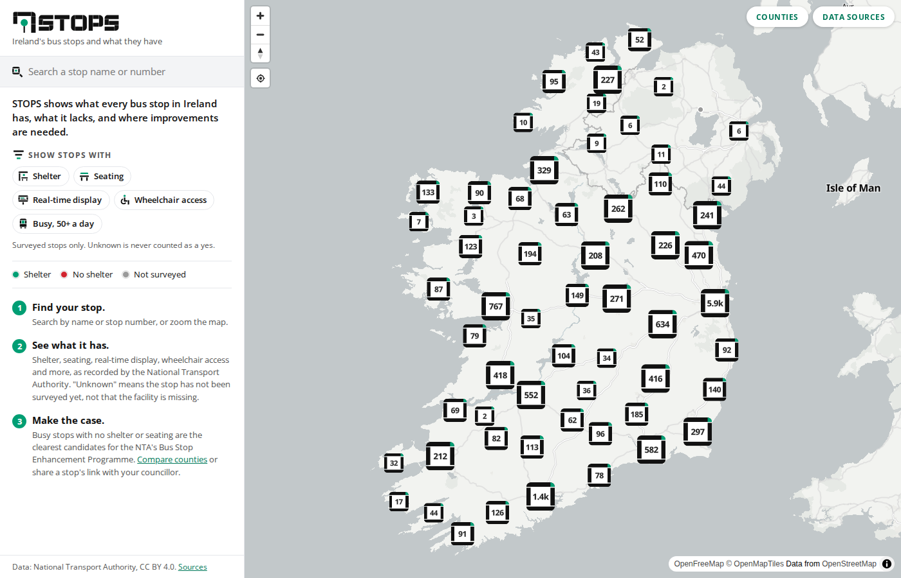

# STOPS

**Ireland's bus stops and what they have.**

A public map of every active bus stop in Ireland showing what the National
Transport Authority (NTA) has on record for it: shelter, seating, real-time
display, wheelchair access, kerb, footpath and more. Filter for stops that have
things, compare counties, and find the busiest stops with no shelter.



The point is not "find my stop". It is to show where public transport
infrastructure is missing, who is affected, and to give communities a record
they can put in front of a councillor or the NTA.

## What it shows

- 16,241 active bus stops, from the NTA stop register.
- For each stop: the facilities the NTA recorded, its A+ to C accessibility
  rating, routes, average weekday departures, and when the record was updated.
- Three states for every facility: **yes**, **no**, and **unknown**. Unknown
  means the NTA has not surveyed the stop. It is never shown as "no".
- A county view: share of surveyed stops with a shelter and seating, and each
  county's busiest stops with no shelter.
- Nearby stops within 400 m, so you can pick the one with a shelter.
- Shareable links, like `/#stop=8220DB000060`.

## Data

All stop data is published by the NTA under
[CC BY 4.0](https://creativecommons.org/licenses/by/4.0/):

| Dataset | What it gives us |
| --- | --- |
| [NaPTAN](https://data.gov.ie/dataset/national-public-transport-access-nodes-naptan) | Stop names, numbers, coordinates |
| [PTIMS](https://data.gov.ie/dataset/public-transport-infrastructure-management-system-ptims) | Shelters, benches, kerbs, accessibility, survey status |
| [GTFS](https://data.gov.ie/dataset/nta-gtfs) | Routes and departure counts |

We join the three on the stop number (AtcoCode) ourselves. County, electoral
area and urban/rural come from [Tailte Éireann](https://data.gov.ie/organization/tailte-eireann)
and CSO boundary files, also CC BY 4.0. Nothing depends on a third party.

The base map is [OpenFreeMap](https://openfreemap.org), built from
[OpenStreetMap](https://www.openstreetmap.org/copyright) data.

Thanks to [NaPTIMFS](https://projects.bibby.ie/naptimfs/) by Thomas Bibby,
whose combined spreadsheet got the project started and was used to check
our own join: the facility fields match it stop for stop.

A record says what the NTA has on file. It is not a guarantee of what is on the
ground today. See [docs/field-check.md](docs/field-check.md) for how we check.

## Running it

Two parts: a Python script that turns the spreadsheet into a map file, and a
React site that shows it.

### 1. Data

```bash
python3 -m venv .venv
source .venv/bin/activate
pip install -r requirements.txt

python scripts/download.py       # fetches about 260 MB into data/raw/
python scripts/build_stops.py    # writes data/processed/
python scripts/check_build.py    # sanity check against the current site data
cp data/processed/stops.geojson data/processed/counties.json data/processed/meta.json web/public/data/
```

- `download.py` fetches NaPTAN, PTIMS and GTFS from the NTA, and the three
  boundary layers from Tailte Éireann's map services.
- `build_stops.py` keeps active bus stops with coordinates, joins the
  infrastructure survey, shelters and real-time displays by stop number,
  counts departures over one reference week from the timetable, places each
  stop in its county, electoral area and urban area, and writes
  `stops.geojson`, a per-county summary `counties.json`, and `meta.json` with
  the build date.
- `check_build.py` refuses a build whose counts dropped by more than 10%.

### Automatic updates

A GitHub Action, `.github/workflows/update-data.yml`, runs those three steps
every Monday and commits the new files if the data changed. The site shows
the build date in its footer. You can also run it by hand from the Actions
tab.

### 2. Website

```bash
cd web
npm install
npm run dev      # local server at http://localhost:5173
npm test         # unit tests
npm run build    # production build in web/dist
```

Stack: React, TypeScript, Vite, MapLibre GL. No backend. The site is static
files and runs on any web host.

## Layout

```
scripts/download.py      fetches the raw files from the publishers
scripts/build_stops.py   builds the stop files, with comments on every step
scripts/check_build.py   sanity check before publishing
scripts/sample_stops.py  picks stops for a field check
.github/workflows/       the weekly data update
data/raw/                downloaded files (not committed)
data/processed/          generated files (not committed)
web/src/                 the React app
web/public/data/         the data the site loads
web/public/icons/        the icon set
docs/                    notes
```

## Before you trust it

Check the records against reality. `scripts/sample_stops.py` picks a sample of
stops near a place or in a county and writes a CSV you can take out with you.
See [docs/field-check.md](docs/field-check.md).

## Licence

Code: [MIT](LICENSE). Data: NTA, CC BY 4.0. Base map: OpenFreeMap and
OpenStreetMap contributors, ODbL.
